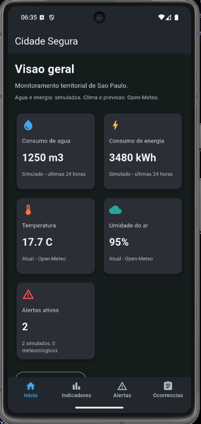
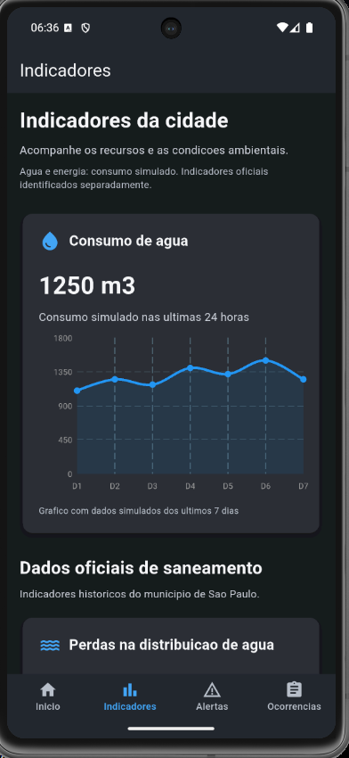
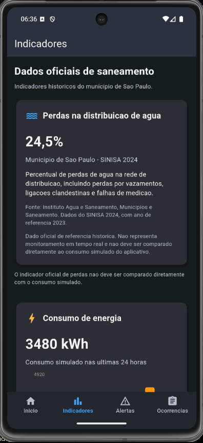
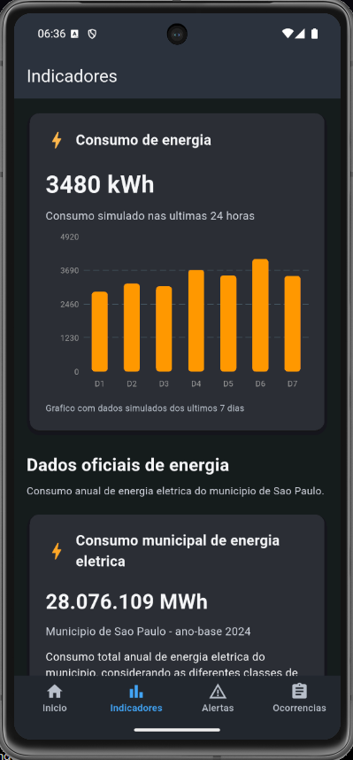
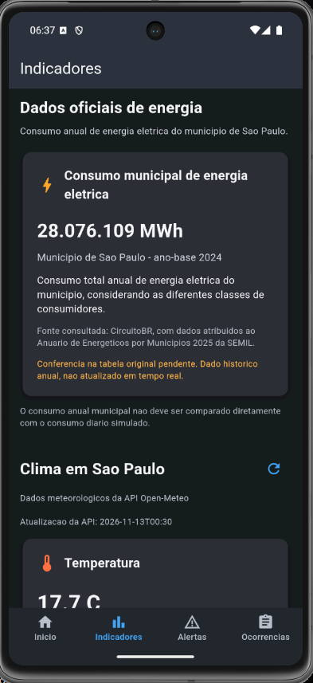
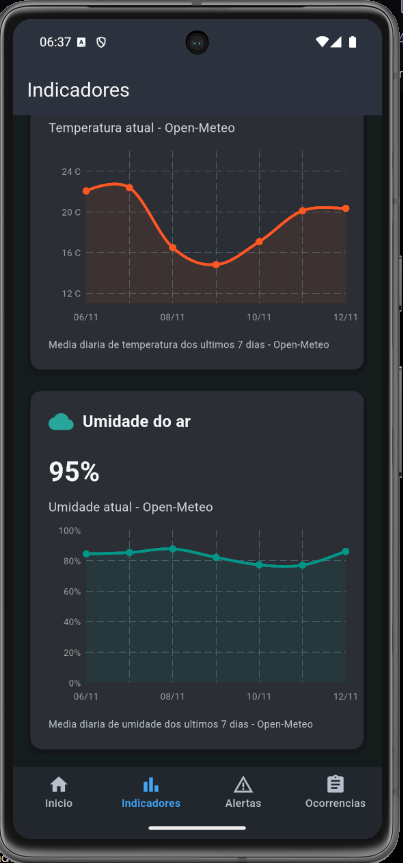
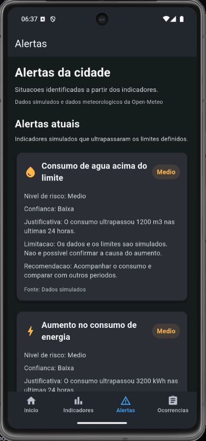
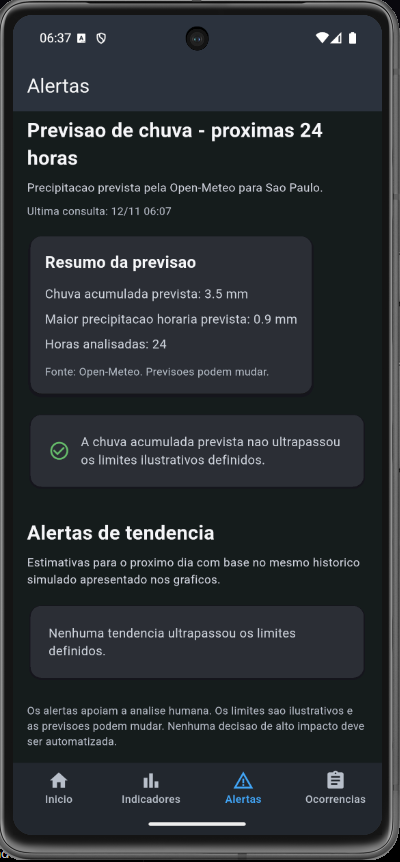
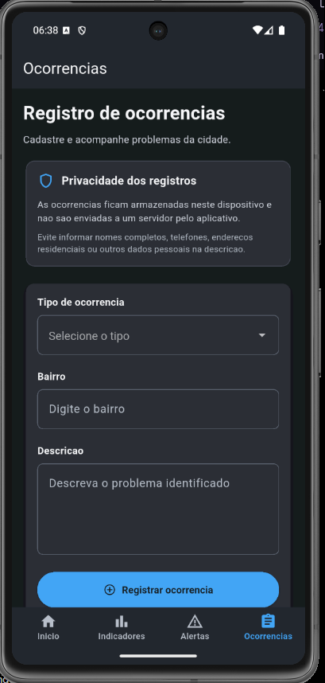

# Cidade Segura

## Integrantes

| Nome completo | RM |
|---|---|
| Arthur Marangoni Furlan | 564665 |
| Vinicius Macedo Carvalho | 563791 |

## Sobre o projeto

O Cidade Segura é um aplicativo desenvolvido em Flutter para a Global Solution da disciplina de Cross-Platform Application Development.

O projeto funciona como um painel de inteligência territorial voltado ao monitoramento de indicadores urbanos do município de São Paulo.

Seu objetivo é auxiliar gestores públicos na identificação de possíveis problemas relacionados ao consumo de água e energia, às condições climáticas e às ocorrências registradas na cidade.

O aplicativo combina dados simulados, informações meteorológicas obtidas por API e indicadores públicos históricos. A partir desses dados, apresenta dashboards, gráficos e alertas acompanhados de justificativas, níveis de confiança, limitações e recomendações.

O Cidade Segura funciona como uma ferramenta de apoio à análise humana, sem automatizar decisões de alto impacto.


## Capturas de tela

Confira algumas das principais funcionalidades do Cidade Segura em execução no Android.

### Visão geral



### Indicadores de água e saneamento

| Consumo de água | Perdas na distribuição |
|---|---|
|  |  |

### Indicadores de energia

| Consumo de energia | Indicador oficial de energia |
|---|---|
|  |  |

### Indicadores climáticos



### Alertas e previsão de chuva

| Alertas atuais | Previsão de chuva |
|---|---|
|  |  |

### Registro de ocorrências




## Funcionalidades

### 1. Tela Início

Apresenta uma visão geral dos principais indicadores monitorados:

- Consumo de água nas últimas 24 horas (simulado).
- Consumo de energia nas últimas 24 horas (simulado).
- Temperatura atual obtida pela Open-Meteo.
- Umidade relativa do ar obtida pela Open-Meteo.
- Quantidade de alertas ativos.
- Atualização manual dos dados meteorológicos.

As informações são exibidas em cartões responsivos, que se adaptam ao tamanho da tela e às configurações de fonte do dispositivo.

### 2. Tela Indicadores

Permite acompanhar os indicadores urbanos e ambientais de forma mais detalhada.

Entre as informações apresentadas estão:

- Gráfico de consumo simulado de água.
- Gráfico de consumo simulado de energia.
- Indicador histórico de perdas na distribuição de água em São Paulo.
- Indicador histórico de consumo municipal de energia elétrica.
- Temperatura atual e histórico climático.
- Umidade atual e histórico climático.

Os gráficos de consumo utilizam dados simulados dos últimos sete dias.

As informações meteorológicas são obtidas por meio da API Open-Meteo, enquanto os indicadores oficiais são apresentados separadamente dos dados simulados.

Os dados públicos históricos não representam monitoramento em tempo real.

### 3. Tela Alertas

Apresenta situações identificadas a partir da análise dos indicadores.

Os alertas são organizados em quatro categorias:

- Alertas atuais de consumo de água e energia.
- Alertas meteorológicos de temperatura e umidade.
- Alertas relacionados à previsão de chuva para as próximas 24 horas.
- Alertas de tendência baseados nos históricos simulados de consumo.

Cada alerta apresenta:

- Título.
- Nível de risco.
- Nível de confiança.
- Justificativa.
- Limitação.
- Recomendação.
- Fonte dos dados.

Os alertas são gerados por regras programadas no aplicativo. Os limites utilizados são ilustrativos e não correspondem a classificações oficiais de risco.

Quando os dados meteorológicos estão indisponíveis ou desatualizados, as análises correspondentes são suspensas até que uma nova consulta válida seja realizada.

O objetivo é apoiar a tomada de decisão de gestores públicos, sem substituir a avaliação humana.

### 4. Tela Ocorrências

Permite cadastrar, visualizar e excluir ocorrências relacionadas a problemas identificados na cidade.

O formulário possui três campos:

- Tipo de ocorrência.
- Bairro.
- Descrição do problema.

Todos os campos são obrigatórios, e a descrição deve conter pelo menos dez caracteres.

As ocorrências ficam armazenadas localmente no dispositivo por meio do SharedPreferences, permanecendo disponíveis mesmo após o fechamento e a reabertura do aplicativo.

A tela também apresenta orientações de privacidade para evitar o registro de informações pessoais desnecessárias.

## Tecnologias utilizadas

| Tecnologia | Utilização |
|---|---|
| Flutter | Desenvolvimento do aplicativo multiplataforma |
| Dart | Linguagem de programação |
| Provider | Gerenciamento de estado |
| HTTP | Comunicação com APIs externas |
| Open-Meteo | Consulta de dados meteorológicos |
| FL Chart | Construção dos gráficos |
| SharedPreferences | Persistência local das ocorrências |
| Material Design | Componentes de interface |
| Git e GitHub | Versionamento e armazenamento do código-fonte |

## Requisitos técnicos implementados

O Cidade Segura contempla os seguintes requisitos:

- Desenvolvimento em Flutter.
- Navegação entre quatro telas.
- Gerenciamento de estado com Provider.
- Consumo de API externa.
- Persistência local de dados.
- Formulário com validação.
- Componentes reutilizáveis.
- Identidade visual própria.
- Interface responsiva.
- Cuidados com acessibilidade e privacidade.
- Alertas explicáveis para apoio à decisão humana.

## Fontes de dados

O aplicativo utiliza dados reais, históricos e simulados, identificados de acordo com sua origem.

### 1. Open-Meteo

A API Open-Meteo é utilizada para consultar:

- Temperatura atual.
- Umidade relativa do ar.
- Histórico de temperatura e umidade.
- Previsão de precipitação para as próximas 24 horas.

**Site oficial:**

https://open-meteo.com/

**Documentação da API:**

https://open-meteo.com/en/docs

As informações dependem da disponibilidade da API e de uma conexão com a internet.

Os dados meteorológicos podem sofrer atualizações e não garantem a ocorrência das condições previstas.

### 2. Instituto Água e Saneamento / SINISA

Utilizado como referência para o indicador histórico de perdas na distribuição de água no município de São Paulo.

**Indicador apresentado no aplicativo:**

- Perdas na distribuição de água: 24,5%.
- Publicação: SINISA 2024.
- Ano de referência dos dados: 2023.

**Fonte consultada:**

https://www.aguaesaneamento.org.br/municipios-e-saneamento/sp/sao-paulo

O indicador representa uma referência histórica e não corresponde ao monitoramento em tempo real da rede de distribuição.

Também não deve ser comparado diretamente com os valores simulados de consumo apresentados no aplicativo.

### 3. Secretaria de Meio Ambiente, Infraestrutura e Logística do Estado de São Paulo (SEMIL)

A publicação utilizada como referência documental é o Anuário de Energéticos por Municípios do Estado de São Paulo 2025, com ano-base 2024.

**Indicador apresentado no aplicativo:**

- Consumo municipal de energia elétrica em 2024: 28.076.109 MWh.

O valor foi identificado na fonte secundária CircuitoBR, que atribui as informações ao anuário da SEMIL.

A conferência direta desse total na tabela original da SEMIL ainda está pendente.

**Publicação oficial da SEMIL:**

https://semil.sp.gov.br/anuario-de-energeticos-por-municipios-do-estado-de-sao-paulo/

**Fonte secundária consultada:**

https://cidades.circuito.tur.br/sp/sao-paulo/sustentabilidade

O indicador corresponde a um dado histórico anual, não sendo atualizado em tempo real pelo aplicativo.

### 4. Dados simulados

Os valores de consumo de água e energia utilizados nos dashboards foram definidos para fins de demonstração acadêmica.

Isso inclui:

- Consumo diário de água.
- Consumo diário de energia.
- Históricos de consumo.
- Estimativas de tendência.

Esses valores são fictícios e não representam medições reais da infraestrutura do município de São Paulo.

A utilização de dados simulados permite demonstrar o funcionamento dos gráficos e dos alertas sem depender de sistemas privados ou de informações sensíveis.

## Funcionamento dos alertas

Os alertas são gerados por regras de análise desenvolvidas no próprio aplicativo.

O sistema considera limites de consumo, condições meteorológicas atuais, previsão de chuva e tendências calculadas a partir dos dados simulados.

Os alertas de tendência utilizam estimativas simplificadas baseadas no comportamento dos históricos de consumo.

Cada alerta apresenta informações que ajudam o usuário a compreender o motivo de sua geração, além das limitações da análise.

O aplicativo não utiliza modelos avançados de inteligência artificial ou aprendizado de máquina para produzir os alertas.

Os níveis de risco e confiança são definidos por regras ilustrativas e não equivalem a avaliações oficiais.

Nenhuma decisão administrativa ou de alto impacto é executada automaticamente.

## Atualização dos dados

O aplicativo realiza consultas à Open-Meteo para obter informações meteorológicas.

O sistema possui:

- Consulta inicial ao abrir o aplicativo.
- Atualização manual dos dados.
- Verificação periódica de desatualização.
- Verificação de atualização ao retornar ao aplicativo.
- Tratamento de falhas de comunicação com a API.

Quando uma consulta apresenta problemas ou os dados ultrapassam o período de validade definido, o aplicativo informa a situação e evita gerar alertas meteorológicos com informações desatualizadas.

Os indicadores oficiais históricos e os dados simulados não são atualizados automaticamente pela API.

## Acessibilidade

O Cidade Segura utiliza uma identidade visual com fundo grafite, textos claros e elementos destacados por cores.

A interface foi desenvolvida com componentes responsivos e passou por testes no emulador Android com diferentes tamanhos de fonte.

Na tela Início, os cartões podem aumentar de altura e ser reorganizados em uma única coluna para acomodar fontes maiores.

Os alertas apresentam seus níveis de risco por meio de textos, evitando que a interpretação dependa exclusivamente das cores utilizadas.

Esses cuidados contribuem para a acessibilidade, embora o projeto ainda não tenha passado por uma auditoria completa com leitores de tela ou outras tecnologias assistivas.

## Privacidade dos dados

O aplicativo utiliza armazenamento local para registrar as ocorrências cadastradas.

Esses registros são armazenados por meio do pacote SharedPreferences e não são enviados a um servidor pelo aplicativo.

O formulário não solicita nome completo, CPF, telefone ou endereço residencial.

A tela Ocorrências orienta os usuários a não incluir dados pessoais desnecessários na descrição dos problemas.

O SharedPreferences não é um mecanismo de armazenamento seguro para informações sensíveis.

Os registros não são sincronizados entre dispositivos e podem ser perdidos caso os dados do aplicativo sejam apagados ou o aplicativo seja desinstalado.

As consultas meteorológicas envolvem comunicação com um serviço externo, a Open-Meteo.

## Limitações do projeto

O Cidade Segura foi desenvolvido com finalidade acadêmica e demonstrativa, apresentando as seguintes limitações:

- Parte dos indicadores de água e energia utiliza dados simulados.
- Os indicadores oficiais apresentados são históricos.
- O total municipal de energia ainda depende de conferência direta na tabela original da SEMIL.
- Os alertas utilizam regras e estimativas simplificadas.
- Os limites de risco são ilustrativos, não oficiais.
- As previsões meteorológicas podem sofrer alterações.
- A disponibilidade dos dados climáticos depende da API Open-Meteo e da conexão com a internet.
- O aplicativo não substitui sistemas oficiais de defesa civil, saneamento ou monitoramento energético.
- As ocorrências ficam armazenadas somente no dispositivo.
- O aplicativo não realiza decisões automáticas de alto impacto.

## Como executar o projeto

### Pré-requisitos

Para executar o Cidade Segura, é necessário ter:

- Flutter SDK instalado.
- Dart SDK, incluído no Flutter.
- VS Code ou Android Studio.
- Emulador Android ou dispositivo compatível.
- Conexão com a internet para consultar os dados meteorológicos.

### 1. Clonar o repositório

```bash
git clone https://github.com/ArtFurlan/cidade_segura.git
```

### 2. Acessar a pasta do projeto

```bash
cd cidade_segura
```

### 3. Instalar as dependências

```bash
flutter pub get
```

### 4. Verificar os dispositivos disponíveis

```bash
flutter devices
```

### 5. Executar no Android

Com um dispositivo ou emulador Android iniciado:

```bash
flutter run
```

Também é possível informar o identificador do dispositivo:

```bash
flutter run -d emulator-5554
```

O identificador pode variar conforme o ambiente utilizado.

### 6. Executar no navegador

```bash
flutter run -d chrome
```

### 7. Executar os testes automatizados

```bash
flutter test
```

### 8. Verificar o código

```bash
flutter analyze
```

### 9. Gerar um APK de depuração

```bash
flutter build apk --debug
```

O arquivo será gerado em:

```text
build/app/outputs/flutter-apk/app-debug.apk
```

## Testes realizados

Durante o desenvolvimento, foram realizados testes automatizados e manuais.

Entre as verificações estão:

- Execução do aplicativo no navegador.
- Execução no emulador Android Pixel 7.
- Navegação entre as quatro telas.
- Consulta aos dados meteorológicos.
- Visualização dos gráficos e alertas.
- Cadastro e exclusão de ocorrências.
- Persistência das ocorrências após fechar e reabrir o aplicativo.
- Adaptação da tela Início a diferentes tamanhos de fonte.
- Verificação visual do tema grafite e da identidade visual.

Na última verificação realizada, o projeto apresentou 15 testes automatizados aprovados e nenhum problema identificado pelo comando `flutter analyze`.

## Identidade visual

O aplicativo utiliza um tema grafite escuro com detalhes em azul, laranja, verde e vermelho.

A identidade visual foi desenvolvida especificamente para o Cidade Segura e inclui uma logo composta por um escudo com elementos relacionados ao monitoramento urbano.

Os símbolos representam:

- Proteção da cidade.
- Monitoramento climático.
- Infraestrutura urbana.
- Tecnologia e acompanhamento de indicadores.

O aplicativo também possui ícone personalizado e tela de abertura compatível com sua identidade visual.

## Contexto acadêmico

O Cidade Segura foi desenvolvido para a Global Solution da disciplina Cross-Platform Application Development.

O projeto busca aplicar conhecimentos de desenvolvimento multiplataforma, integração com APIs, gerenciamento de estado, persistência de dados, construção de interfaces responsivas e visualização de indicadores.

Sua proposta é demonstrar como a tecnologia pode auxiliar gestores públicos na identificação de problemas e na análise de informações relacionadas à qualidade de vida da população.
